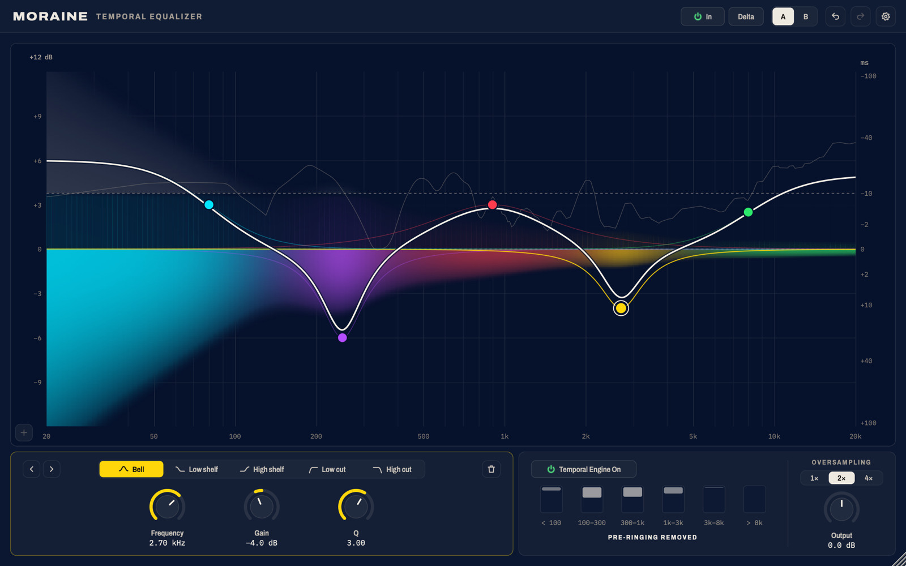

# Moraine

Moraine is an equaliser for mixing and mastering. It gives the frequency response of a
linear-phase equaliser at a latency of 10 ms, and it removes the pre-ringing that a
linear-phase equaliser places ahead of transients. A neural network, the Temporal Engine,
examines the signal 10 ms ahead in six frequency bands, determines where the ringing ahead of
a transient would be audible, and removes it in that band alone. Where the pre-ringing is
masked, nothing is removed, and Moraine behaves as a linear-phase equaliser.

This repository is where Moraine releases are published. **[Download the latest
release](../../releases/latest).** The user guide is published beside the installer.

## Features

- Up to five bands, each a bell, a low or high shelf, or a low or high cut.
- A display that draws the curve over a map of where in time its change falls, so that the
  ringing each band causes before and after a transient may be seen.
- Six meters showing how much pre-ringing is removed in each band of the Temporal Engine.
- **Delta**, which plays only what the Temporal Engine removes.
- Oversampling at 1×, 2× or 4×, with 2× as the default.
- A and B settings for comparison, with undo and redo.

## Requirements

- macOS 11 or later, on Apple silicon.
- A host that loads Audio Units, VST3 or AAX plug-ins: Logic Pro, Pro Tools, Ableton Live,
  Cubase, REAPER, Studio One and others.

## Installation

The installer, a `.pkg` file, installs Moraine for all users:

- the Audio Unit in `/Library/Audio/Plug-Ins/Components`;
- the VST3 in `/Library/Audio/Plug-Ins/VST3`;
- the AAX in `/Library/Application Support/Avid/Audio/Plug-Ins`.

Any format may be left out by choosing **Customize** in the installer. The installer is
signed with a Developer ID and notarised by Apple.

## Trial and licence

Without a licence, Moraine runs in full, but a short tone sounds every 30 seconds of audio.
To activate it, enter the e-mail address to which the licence was issued and the licence
token in the panel that opens with the plug-in, or later from the cog in the header.
Activation takes place offline and covers every Moraine instance on that user account.

## Removal

Delete `Moraine.component` from `/Library/Audio/Plug-Ins/Components`, `Moraine.vst3` from
`/Library/Audio/Plug-Ins/VST3` and `Moraine.aaxplugin` from
`/Library/Application Support/Avid/Audio/Plug-Ins`.

---

© Mark Hammond. All rights reserved.
